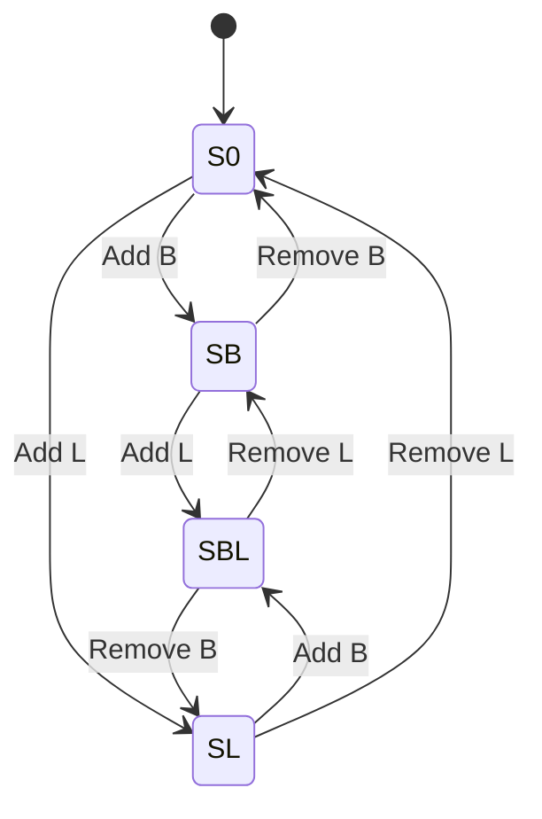
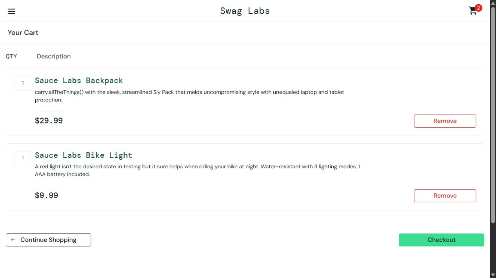

# Lab 02: Black Box Testing

**Course:** AD361 H11 28561 — Fall 2026  
**Website:** [Sauce Demo (Swag Labs)](https://www.saucedemo.com/)  
**Observation date:** October 22, 2026

## 1. Website and selected features

Sauce Demo is a sample shopping website with public test accounts, a product list, and a shopping cart. Its visible login feedback and cart controls make it suitable for testing input classes, combinations of conditions, and changes in application state.

The two features covered are:

1. **Login:** submitting a username and password, including missing values, incorrect credentials, and a locked account.
2. **Shopping cart:** adding and removing the Sauce Labs Backpack and Sauce Labs Bike Light from the Products page.

The tests use only browser inputs and observable outputs: page navigation, error messages, button labels, cart counts, and cart contents. No application source code was inspected. Expected results are based on the public login instructions and the behavior implied by the visible controls; no separate requirements specification was supplied.

### Scope and setup

- Use the public accounts `standard_user` and `locked_out_user`. The site displays `secret_sauce` as their test password.
- Other special-purpose demo accounts are outside this test plan.
- For login tests, start on the login page and replace both field values for each case. After a successful login, log out before another login test.
- For cart tests, log in as `standard_user`, start with an empty cart, and leave all other products unselected.
- Cart state refers to selected products, not the page currently displayed. Opening the cart and returning to Products should preserve those selections.
- Checkout, payments, account creation, direct HTTP requests, and server-side security enforcement are outside scope.
- Tests were executed in a browser session on Windows. The browser engine/version was not recorded.

## 2. Equivalence partitioning: login

Inputs in each partition should produce the same type of result. Except for the value being varied, the other field contains a known valid value. An empty value is written as `""`; the quotation marks are not entered.

The username classes below partition the scoped username domain into empty, the selected active account, the selected locked account, and unrecognized nonempty values. The password classes are defined relative to `standard_user`.

| Partition | Input class | Validity for successful login | Representative username | Representative password | Expected result | Test |
|---|---|---|---|---|---|---|
| EP-U1 | Selected active username | Valid | `standard_user` | `secret_sauce` | Open the Products page. | L01 |
| EP-U2 | Selected locked username | Invalid for access; recognized account | `locked_out_user` | `secret_sauce` | Remain on login and show a locked-account error. | L02 |
| EP-U3 | Unrecognized, nonempty username | Invalid | `nonexistent_user` | `secret_sauce` | Remain on login and show a credential-mismatch error. | L03 |
| EP-U4 | Empty username | Invalid | `""` | `secret_sauce` | Remain on login and show a username-required error. | L04 |
| EP-P1 | Correct password for the active account | Valid | `standard_user` | `secret_sauce` | Open the Products page. | L01 |
| EP-P2 | Nonempty, incorrect password | Invalid | `standard_user` | `wrong_password` | Remain on login and show a credential-mismatch error. | L05 |
| EP-P3 | Empty password | Invalid | `standard_user` | `""` | Remain on login and show a password-required error. | L06 |

L01 represents both EP-U1 and EP-P1 because it contains a valid username/password pair. L07, with both inputs empty, is an additional combination test used to check validation precedence. Whitespace-only values and leading/trailing spaces are not separate partitions here; trimming behavior would need additional tests. No undocumented minimum or maximum input length is assumed.

## 3. Decision table testing: login

### Conditions and actions

- **C1:** The username field is nonempty.
- **C2:** The password field is nonempty.
- **C3:** When both fields are nonempty, classify the credential pair as:
  - **A:** `standard_user` with `secret_sauce`.
  - **L:** `locked_out_user` with `secret_sauce`.
  - **X:** Any other pair in the scoped test domain.
- **Actions:** open Products, or remain on login and display the applicable error.

This is a reduced, multi-value decision table. **Y** means yes, **N** means no, **—** means the condition does not affect that rule, and **✓** marks the expected action. The pair categories are mutually exclusive. R1 takes precedence when both fields are empty.

| Condition / action | R1 | R2 | R3 | R4 | R5 |
|---|---|---|---|---|---|
| C1: Username nonempty? | N | Y | Y | Y | Y |
| C2: Password nonempty? | — | N | Y | Y | Y |
| C3: Credential-pair class | — | — | A | L | X |
| Open Products |  |  | ✓ |  |  |
| Show username-required error | ✓ |  |  |  |  |
| Show password-required error |  | ✓ |  |  |  |
| Show locked-account error |  |  |  | ✓ |  |
| Show credential-mismatch error |  |  |  |  | ✓ |
| Remain on login | ✓ | ✓ |  | ✓ | ✓ |

### Decision-table test cases and observations

**Procedure for each case:** open the login page, replace the username and password with the listed values, click **Login**, and compare the resulting page and feedback with the expected result. These cases also execute the representatives from the equivalence-partition table.

| Test | Rule | Username | Password | Expected result | Actual result on October 22 | Status |
|---|---|---|---|---|---|---|
| L01 | R3 | `standard_user` | `secret_sauce` | Products opens; no login error. | Navigated to `/inventory.html`; Products displayed. | Pass |
| L02 | R4 | `locked_out_user` | `secret_sauce` | Locked-account error; stay on login. | Locked-account message displayed; login form remained. | Pass |
| L03 | R5 | `nonexistent_user` | `secret_sauce` | Credential-mismatch error; stay on login. | Credential-mismatch message displayed; login form remained. | Pass |
| L04 | R1 | `""` | `secret_sauce` | Username-required error; stay on login. | Username-required message displayed; login form remained. | Pass |
| L05 | R5 | `standard_user` | `wrong_password` | Credential-mismatch error; stay on login. | Credential-mismatch message displayed; login form remained. | Pass |
| L06 | R2 | `standard_user` | `""` | Password-required error; stay on login. | Password-required message displayed; login form remained. | Pass |
| L07 | R1 | `""` | `""` | Username-required error has precedence. | Username-required message displayed; login form remained. | Pass |

**Coverage:** all seven partition representatives and all five decision rules are covered by seven login cases. R1 is exercised with both an empty and a nonempty password. R5 is exercised by an unknown username and an incorrect password for the active account. The results do not establish behavior for every possible invalid string or combination involving the excluded demo accounts.

## 4. State transition testing: shopping cart

### States

Let **B** mean Sauce Labs Backpack and **L** mean Sauce Labs Bike Light. A product is either selected once or absent in this UI model.

| State | Selected products | Cart badge | Backpack control | Bike Light control |
|---|---|---|---|---|
| S0 | None | No numeric badge | Add to cart | Add to cart |
| SB | B only | 1 | Remove | Add to cart |
| SL | L only | 1 | Add to cart | Remove |
| SBL | B and L | 2 | Remove | Remove |

### Events and validity

- **Add B / Add L:** click that product's **Add to cart** button on Products.
- **Remove B / Remove L:** click that product's **Remove** button on Products.
- A valid transition adds an absent product or removes a present product.
- An invalid transition attempts to add an already selected product or remove an absent product. The expected UI behavior is that the corresponding action is unavailable, so the state remains unchanged.

For invalid transitions, the test checks the unavailable control rather than issuing a fabricated request. This verifies a UI guard; it does not prove that a server would reject a forged request.

### Completed state transition table

Each cell lists the next state and its test ID. **Blocked** means no transition should be available through the normal UI; the state in parentheses is retained.

| Current state | Add B | Add L | Remove B | Remove L |
|---|---|---|---|---|
| S0 | SB — ST01 | SL — ST05 | Blocked (S0) — ST09 | Blocked (S0) — ST10 |
| SB | Blocked (SB) — ST11 | SBL — ST02 | S0 — ST08 | Blocked (SB) — ST12 |
| SL | SBL — ST06 | Blocked (SL) — ST13 | Blocked (SL) — ST14 | S0 — ST04 |
| SBL | Blocked (SBL) — ST15 | Blocked (SBL) — ST16 | SL — ST03 | SB — ST07 |

### State diagram

The diagram shows valid transitions; the table also covers the eight blocked state/event combinations.

### Valid-transition test cases

Run **ST01 → ST02 → ST03 → ST04** as one sequence and **ST05 → ST06 → ST07 → ST08** as a second sequence. Each sequence begins and ends with an empty cart. For an isolated rerun, establish the listed starting state using only the two selected products, then perform the action. Verify both product-button labels as well as the badge: a count of 1 alone cannot distinguish SB from SL.

| Test | Starting state | Action | Expected result | Actual result | Status |
|---|---|---|---|---|---|
| ST01 | S0 | Click Add to cart for B. | SB; badge 1; B shows Remove, L shows Add. | SB controls and badge 1 observed. | Pass |
| ST02 | SB | Click Add to cart for L. | SBL; badge 2; both show Remove. | SBL controls and badge 2 observed. | Pass |
| ST03 | SBL | Click Remove for B. | SL; badge 1; B shows Add, L shows Remove. | SL controls and badge 1 observed. | Pass |
| ST04 | SL | Click Remove for L. | S0; no badge; both show Add. | S0 controls and empty cart indicator observed. | Pass |
| ST05 | S0 | Click Add to cart for L. | SL; badge 1; B shows Add, L shows Remove. | SL controls and badge 1 observed. | Pass |
| ST06 | SL | Click Add to cart for B. | SBL; badge 2; both show Remove. | SBL controls and badge 2 observed. | Pass |
| ST07 | SBL | Click Remove for L. | SB; badge 1; B shows Remove, L shows Add. | SB controls and badge 1 observed. | Pass |
| ST08 | SB | Click Remove for B. | S0; no badge; both show Add. | S0 controls and empty cart indicator observed. | Pass |

After ST02, the cart was also opened. It listed B and L, each with quantity 1. **Continue Shopping** returned to Products with both products still selected. The two transition sequences ended with an empty cart.

### Invalid-transition test cases

For each case, establish the listed state, inspect the named product's controls, and verify that the prohibited action is unavailable and the state is unchanged. Do not click the opposite action to simulate the prohibited event.

| Test | Starting state | Prohibited event | Expected result | Actual observation | Status |
|---|---|---|---|---|---|
| ST09 | S0 | Remove B | No Remove for B; retain S0. | B offered Add only; cart empty. | UI guard verified |
| ST10 | S0 | Remove L | No Remove for L; retain S0. | L offered Add only; cart empty. | UI guard verified |
| ST11 | SB | Add B again | No Add for B; retain SB. | B offered Remove only; badge 1. | UI guard verified |
| ST12 | SB | Remove L | No Remove for L; retain SB. | L offered Add only; badge 1. | UI guard verified |
| ST13 | SL | Add L again | No Add for L; retain SL. | L offered Remove only; badge 1. | UI guard verified |
| ST14 | SL | Remove B | No Remove for B; retain SL. | B offered Add only; badge 1. | UI guard verified |
| ST15 | SBL | Add B again | No Add for B; retain SBL. | B offered Remove only; badge 2. | UI guard verified |
| ST16 | SBL | Add L again | No Add for L; retain SBL. | L offered Remove only; badge 2. | UI guard verified |

**Coverage:** all four states, all eight valid transitions, and all eight blocked combinations in the four-state/four-event model were checked. This is coverage of the selected two-product model, not of every possible cart state or sequence on the site.

## 5. Evidence and findings

The browser checks covered seven login cases, eight valid cart transitions, and eight checks of unavailable actions. The sampled behavior matched the expected results. No defect was observed within this scope.

| Evidence | What it demonstrates |
|---|---|
| [Empty cart](evidence/cart-empty.png) | S0: both tested products offer Add to cart; no numeric badge. |
| [Backpack only](evidence/cart-backpack.png) | SB: backpack offers Remove, bike light offers Add, badge is 1. |
| [Bike light only](evidence/cart-bike-light.png) | SL: bike light offers Remove, backpack offers Add, badge is 1. |
| [Both products](evidence/cart-both.png) | SBL: both products offer Remove; badge is 2. |
| [Cart contents](evidence/cart-contents.png) | The cart lists the backpack and bike light, each with quantity 1. |

These screenshots document the cart states, while the login table records the observed login results. The screenshots do not independently document every click. Behavior outside the listed cases remains untested.

## 6. Deliverable checklist

- Website name, URL, and two selected features: Section 1.
- Valid and invalid partitions, representative values, and expected results: Section 2.
- Conditions, actions, completed decision table, and derived test cases: Section 3.
- States, events, valid/invalid transitions, completed transition table, and derived test cases: Section 4.
- Browser observations and screenshots: Sections 3–5.
- Submission: publish this report and the `evidence/` directory in a **public GitHub repository**, then submit that repository's URL in Canvas.
